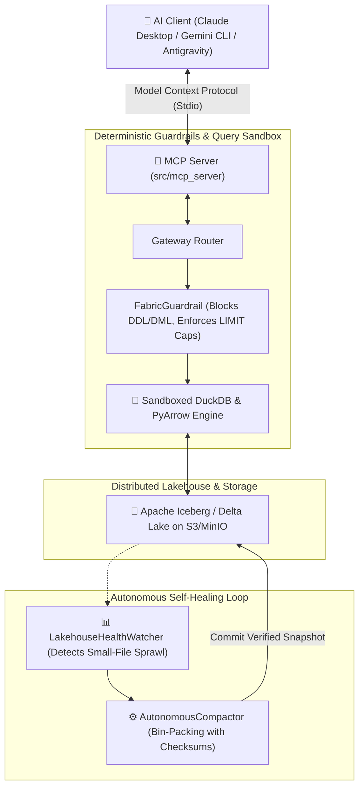

# 🤖 Enterprise Agentic Data Fabric & Autonomous MCP Governor

[](LICENSE)
[](https://modelcontextprotocol.io/)
[](https://duckdb.org/)
[](https://arrow.apache.org/)
[](.github/workflows/ci.yml)

A production-grade **Deterministic Data Fabric** enabling autonomous AI agents (Claude, Gemini, Antigravity, Cursor) to discover, inspect, query, and govern Lakehouse assets via the **Model Context Protocol (MCP)** with an integrated **Self-Healing Compaction Governor**.

---

## 🏛️ System Architecture



---

## ⚡ Model Context Protocol (MCP) Tools Catalog

| MCP Tool Name | Target Scope | Safety & Determinism Controls |
| :--- | :--- | :--- |
| `lakehouse_inspect_schema` | Table Schema & Metadata | Returns column data types, nullability, row counts, and storage format. |
| `lakehouse_explain_query` | Query Plan Optimization | Parses AST, analyzes sequential scans, and suggests partition pruning. |
| `lakehouse_query_sandboxed` | Read-Only Analytical SQL | Enforces AST validation (blocks mutations), caps row output (max 100), 5s timeout. |
| `governor_audit_pipeline` | Storage & File Health | Telemetry auditor returning small-file fragmentation index and skew. |
| `governor_trigger_compaction` | Autonomous Self-Healing | Executes columnar bin-packing with pre- and post-compaction row checksum validation. |

---

## 🚀 Antigravity MCP Routing Configuration

To route Google Antigravity / Gemini CLI through this server, add this entry to `~/.gemini/config/mcp_config.json`:

```json
{
  "mcpServers": {
    "agentic-data-fabric": {
      "command": "python",
      "args": ["-m", "src.mcp_server.server"],
      "cwd": "C:/Users/amitt/Documents/github/agentic-data-fabric"
    }
  }
}
```

---

## 📜 Governance & Licensing
Licensed under the [Apache License 2.0](LICENSE). Maintained under enterprise architectural governance by Amitkumar Tiwari.
